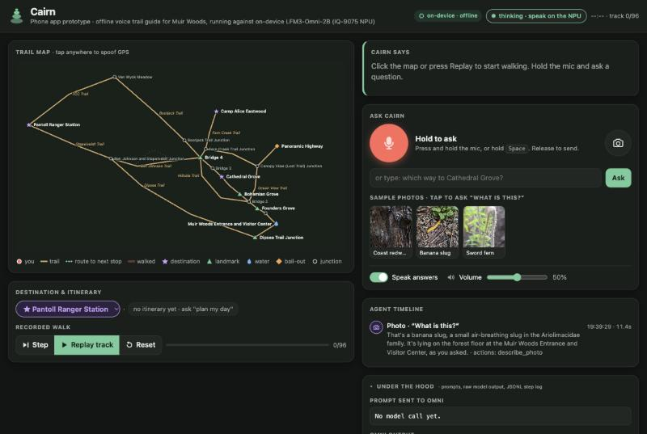

# Cairn: an offline voice trail guide

Cairn is a prototype of a phone app: an always-on trail companion for Muir Woods that runs entirely on a Qualcomm Dragonwing IQ-9075. It watches your position against a local trail map and warns you when you go off-route, are too slow to get back before sunset, or have stopped moving for too long. At a junction you can hold a button and ask "which way to Cathedral Grove?". It tells you which trail to take, in two or three plain sentences, and can read the answer aloud on the board's speakers.



Arduino Project Hub: https://projecthub.arduino.cc/projects/9edf5e50-9d90-4aae-8f20-cc3eb822b81d

## Why not a cloud API call?

There is no signal in the backcountry, which is exactly where a hiker needs directions. An always-on watcher that is meant to keep you safe cannot depend on a connection, so the model, the map and every decision live on the board.

## How it works

```text
position (replayed track, or a click on the map)
   -> rules in plain Python: off_route, sunset pace, no_movement, junction arrival
   -> allowlisted actions: log_alert, nearest_bailout, route_at_junction, nearest_water, speak
   -> LFM3-Omni-2B on the Hexagon NPU (ZETIC Ixian SDK 0.2.1): explain only on alerts, junctions or questions
   -> one flushed JSONL line per iteration or request
```

- **The model does no maths.** Distances (haversine), compass bearings, Dijkstra routing over the trail graph, pace and time-to-sunset are all computed in code. Omni only does three things: transcribes the spoken question, turns the computed facts into short sentences, and optionally speaks them.
- **Memory.** Cairn keeps a breadcrumb trail of where you have been, so a route answer knows which junction you came from and won't send you back the way you came. It also keeps the last few questions and answers and an ordered itinerary ("Cathedral Grove first, then Pantoll").
- **Camera: "What is this?"** The phone camera (the laptop webcam in this prototype) or a sample photo goes to `/api/look` as a 512×512 image. Omni describes it on the NPU, code matches the description to local knowledge, and a second capped call answers like a guide. For example, a photo of "a bright yellow, elongated organism" becomes "That's a banana slug…".
- **Local knowledge.** `data/area_context.json` holds Wikipedia summaries (CC BY-SA 4.0) fetched once during setup. Code picks one or two relevant snippets per answer, so the guide talks like a friend who knows the area.
- **Guards.** Every model call is capped (ASR 96 tokens, answers 120). Each is checked for an empty answer, a natural stop and current-request Hexagon v73/two-NSP evidence, and retried once. Prompts carry a unique `[request:uuid]` tag. Errors are logged as data and the loop keeps running. Anything not on the allowlist is refused and logged.
- **Standard library only.** Nothing is fetched at runtime: no map tiles, CDN or fonts. The map is an inline SVG drawn from `data/trails.json`.

## Files

| File | What it is |
|---|---|
| `cairn.py` | The loop, rules, routing, allowlist, Omni calls and local web UI server |
| `ui.html` | The single-page UI: SVG map (click to spoof GPS), hold-to-talk, prompt/output/step-log panels |
| `run.py` | A copy of `examples/zetic-lfm/run.py` whose device check also accepts SDK 0.2.1's `nsp2=1` line |
| `data/trails.json` | Muir Woods trail graph: trailheads, junctions, water, bail-out points, destinations, sunset |
| `data/track.json` | Replayed hike (`make_track.py` regenerates it) that triggers every rule |
| `data/area_context.json` | Local background knowledge (Wikipedia summaries) |
| `data/samples/` | Stand-in camera photos, 512×512 PPM, from Wikimedia Commons: "Redwood Trunk" by ~jar() (CC BY 4.0), "Banana Slug on the ground" (CC BY-SA 4.0), "Sword fern polystichum munitum" (public domain) |

## Run it

On the **board**, with the ZETIC SDK at `~/zetic-demo/sdk` and the LFM3-Omni-2B v73 package at `~/zetic-demo/models/lfm3-omni-2b`, from the repo root:

```bash
python3 apps/cairn/cairn.py replay --iterations 40          # headless always-on run over the track
python3 apps/cairn/cairn.py serve --port 8080               # web UI, bound to 127.0.0.1 only
```

From the **laptop**, open the UI through an SSH tunnel so the browser treats it as `localhost`, which the microphone needs:

```bash
ssh -o 'ProxyCommand nc -b en5 %h %p' -L 8080:127.0.0.1:8080 ubuntu@169.254.77.1
```

Then go to http://localhost:8080. The laptop is only the microphone and the screen; transcription, answers and speech run on the board. `--mock-llm` swaps in canned text for laptop-only UI tests.

### Offline access path

The demo runs with the board's Wi-Fi off, so the laptop reaches the board over a USB-C cable on the ADB port, configured as a USB network (CDC-NCM) gadget with link-local addresses and no internet sharing. Run `sudo bash apps/cairn/usb_link.sh` on the board from the UART console (it does not persist across a reboot). The board takes `169.254.77.1` and macOS self-assigns a `169.254.x` address on the new interface. Because macOS may route `169.254/16` over Wi-Fi, pin the SSH connection to the USB interface, for example `ssh -o 'ProxyCommand nc -b en5 %h %p' -L 8080:127.0.0.1:8080 ubuntu@169.254.77.1` (check the interface name with `ifconfig`).

## Measured on our board

IQ-9075 EVK, Ubuntu 24.04, ZETIC Ixian Hexagon SDK 0.2.1, LiquidAI LFM3-Omni-2B (ZETIC v73 two-NSP package, revision `01d43f16`). The CLI reloads the model for every call.

Measured on 2026-11-13 from Cairn's own JSONL logs on the board (one replay of 50 iterations plus UI questions). Medians:

| Call | Samples | Wall time | Model load | Time to first token | Decode |
|---|---:|---:|---:|---:|---:|
| Explain an alert, junction or landmark (cap 120 tokens) | 6 | 4.81 s | 3.76 s | 113 ms | 62.4 tok/s |
| Answer a question (cap 120 tokens) | 2 | 4.85 s | 3.72 s | 111 ms | 61.3 tok/s |
| Transcribe a spoken question (cap 96 tokens) | 1 | 4.23 s | 3.73 s | 74 ms | 52.4 tok/s |
| Speak an answer (TTS, before the 60-token cap) | 2 | 11.1 s for 25.3 s of audio | | | |

- 9 of 9 model calls passed every check (usage, non-empty answer, natural stop, current-request Hexagon evidence). 53 log records, 0 with errors.
- Device evidence per call: `hexrt open … v73 … nsp2=1` and `loaded lfm3-omni-2b v73`, with the CLI reporting `target v73 (v73, 2 NSP) soc QCS9075`. CPU threads also take part, so we do not claim the work runs entirely on the NPU.
- Most of each call's wall time is the model reload. A resident server would cut answers to under a second, which is the obvious next step.
- These are small samples from one board, not a benchmark.

## Offline status

- **Static audit:** no HTTP clients, sockets to other hosts, CDN, map tiles or web fonts in `cairn.py`, `run.py` or `ui.html`. The only URL is the SVG XML namespace string, which browsers never fetch. Standard library only.
- **Runtime check:** while Cairn answered a question, the board's only established connections were loopback (the UI server) and the USB-link SSH session from the laptop.
- **Assets on the board:** the SDK, the model package (SHA-256 verified against the package's `SHA256SUMS`), trail data and area knowledge are all local files.
- **Not performed:** a run with the board's Wi-Fi switched off. We skipped the network-off rehearsal, so this is unverified until the judge's table.
